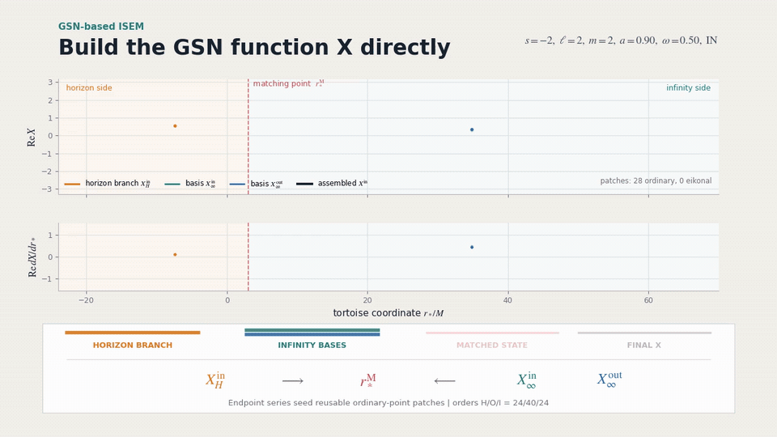

# GeneralizedSasakiNakamura.jl


[](https://github.com/ricokaloklo/GeneralizedSasakiNakamura.jl/releases)
[](https://ricokaloklo.github.io/GeneralizedSasakiNakamura.jl/dev/)

GeneralizedSasakiNakamura.jl solves the frequency-domain radial Teukolsky equation of a Kerr black hole with the Generalized Sasaki-Nakamura (GSN) formalism. It handles *both ingoing and outgoing* radiation of scalar, electromagnetic and gravitational type (spin weight $s = 0, \pm 1, \pm 2$), accepts *complex* frequencies, and uses the $M = 1$ convention throughout. Beyond the source-free (homogeneous) equation, it computes the waveform amplitudes and fluxes radiated by a test particle on a generic bound Kerr geodesic.

The angular Teukolsky equation is solved with the accompanying package [SpinWeightedSpheroidalHarmonics.jl](https://github.com/ricokaloklo/SpinWeightedSpheroidalHarmonics.jl) using a spectral decomposition method.

The paper describing both the GSN formalism and the implementation can be found in [2306.16469](https://arxiv.org/abs/2306.16469). A set of Mathematica notebooks deriving all the equations used in the code can be found in [10.5281/zenodo.8080241](https://doi.org/10.5281/zenodo.8080241).

**Contents**
- [What's new in v0.10.0](#whats-new-in-v0100)
- [Installation](#installation)
- [Homogeneous solvers](#homogeneous-solvers)
  - [Solver methods](#solver-methods)
  - [Basic radial-solution example](#basic-radial-solution-example)
  - [Complex frequencies, quasinormal modes, and excitation factors](#complex-frequencies-quasinormal-modes-and-excitation-factors)
- [Inhomogeneous solvers](#inhomogeneous-solvers)
  - [Point-particle sources and single-mode solutions](#point-particle-sources-and-single-mode-solutions)
  - [Total fluxes](#total-fluxes)
- [How to cite](#how-to-cite)
- [License](#license)

## What's new in v0.10.0

Version 0.10.0 adds a GSN-based ISEM solver, which solves the generalized Sasaki–Nakamura equation directly in about a millisecond for real and complex frequencies, including exact extremality $a = \pm 1$, and a Kerr quasinormal-mode solver, `qnm`, which returns QNM frequencies with their amplitudes and excitation factors for any spin up to $a = 1$. The mode and flux solvers also support thread-safe parallel calls. The total-flux summations extrapolate the geometric tail beyond their stopping point (the `n` sum of highly eccentric orbits, the ℓ sum of circular orbits) and skip modes whose flux is negligible on analytic grounds; their `tol` is a stopping threshold (see [Total fluxes](#total-fluxes)).

Earlier releases: v0.8.0 added waveform amplitudes and fluxes at infinity and at the horizon for a test particle on a _generic (eccentric, inclined) timelike bound orbit_, by solving the inhomogeneous Sasaki–Nakamura (SN) equation using integration by parts; v0.9.0 added the ISEM solver (_iterative series expansion matching_) and the high-level total-flux interface `Teukolsky_pointparticle_flux`.

## Installation
Julia 1.12 or later in the 1.x series is required.

To install the package using the Julia package manager, simply type the following in the Julia REPL:
```julia
using Pkg
Pkg.add("GeneralizedSasakiNakamura")
```

*Note: There is no need to install [SpinWeightedSpheroidalHarmonics.jl](https://github.com/ricokaloklo/SpinWeightedSpheroidalHarmonics.jl) separately as it should be automatically installed by the package manager.*

Version 0.10 requires KerrGeodesics v0.5.2 and SpinWeightedSpheroidalHarmonics v1.5, both available from the General registry.

## Homogeneous solvers

These solvers construct source-free radial solutions with prescribed boundary conditions (`IN`: purely ingoing at the horizon; `UP`: purely outgoing at infinity), together with their asymptotic amplitudes. `Teukolsky_radial` and `GSN_radial` accept real and complex frequencies.

### Solver methods

The `method` keyword selects the solver. The default `method = "auto"` uses ISEM and falls back to the legacy automatic route only if ISEM fails.

#### Numerical integration (`method = "linear"` or `"Riccati"`)

The original GSN solver works at *both low and high frequencies* by numerically evolving the radial equation with the `linear` or `Riccati` method and attaching analytical boundary ansatzes near the horizon and infinity:

<p align="center">
  
</p>

The on-the-fly benchmark against the Mathematica implementation of the Mano–Suzuki–Takasugi (MST) method is shown below:

<table>
  <tr>
    <th>GeneralizedSasakiNakamura.jl numerical solver</th>
    <th><a href="https://github.com/BlackHolePerturbationToolkit/Teukolsky">Teukolsky</a> Mathematica package using the MST method </th>
  </tr>
  <tr>
    <td><p align="center"></p></td>
    <td><p align="center"></p></td>
  </tr>
</table>

*(There was no caching in this benchmark; the equation was solved on the fly. The animation was made with an earlier version of [examples/realtime-demo.ipynb](examples/realtime-demo.ipynb), which now runs the ISEM solver.)*

#### ISEM (`method = "ISEM"`)

ISEM (iterative series expansion matching) constructs the GSN radial function $X$ from series expansions matched on the generalized Sasaki–Nakamura equation itself: local solutions at the horizon and at infinity (with small-frequency and large-frequency expansions where they apply) are continued by ordinary-point series and matched at an interior point. The Teukolsky function $R$ and the auxiliary function $Y$ used by the point-particle convolutions are transformations of that same solution:

<p align="center">
  
</p>

`method = "ISEM"` selects it strictly, with no fallback. The default `method = "auto"` first tries ISEM with automatic frequency, spin, representation and matching controls; if ISEM throws, it falls back to the legacy automatic radial route (with a debug log message). The homogeneous radial Teukolsky/GSN equations are solved typically at millisecond timescale or faster, and this route is also used by the single-mode point-particle amplitudes and total-flux mode summations. Optional controls are the matching point `xm` in $(0,1)$, the expansion order `N`, the tolerance `tol`, and the small- and large-frequency expansion switches `sfe` and `lfe`; see the [API reference](https://ricokaloklo.github.io/GeneralizedSasakiNakamura.jl/dev/APIs/).

Superradiance-threshold solutions with $\omega = m a / (2 r_+)$ are built with a logarithmic horizon solution, while static/zero-frequency solutions are solved analytically with Gauss hypergeometric functions.

The GSN-ISEM on-the-fly solve and evaluation speed:

<p align="center">
  
</p>

*Change from v0.9.0:* in v0.10.0, `method = "ISEM"` solves the GSN equation directly. The v0.9.0 ISEM matched series solutions of the Teukolsky equation; it has been replaced, together with its `rhom`, `TSinInf`/`TSoutInf`/`TSinHor`/`TSoutHor` controls and its negative `xm` coordinate.

### Basic radial-solution example

The following snippet solves the (source-free) Teukolsky function for the mode $s=-2, \ell=2, m=2, a/M=0.7, M\omega=0.5$ with the purely-ingoing boundary condition at the horizon, $R^{\textrm{in}}$, and the purely-outgoing boundary condition at spatial infinity, $R^{\textrm{up}}$:
```julia
using GeneralizedSasakiNakamura # This is going to take some time to pre-compile

# Specify which mode to solve
s=-2; l=2; m=2; a=0.7; omega=0.5;

# NOTE: julia uses 'just-ahead-of-time' compilation. Calling this the first time in each session will take some time
Rin, Rup = Teukolsky_radial(s, l, m, a, omega)
```
That's it! In the Julia REPL this returns

<details>
<summary>Output</summary>

```
(
TeukolskyRadialFunction(
    mode = Mode(s = -2, l = 2, m = 2, a = 0.7, omega = 0.5, lambda = 1.6966094016353415),
    boundary_condition = IN,
    transmission_amplitude = 1.0 + 0.0im,
    incidence_amplitude = 6.536587661184241 - 4.941203897065112im,
    reflection_amplitude = -0.12824661912909405 - 0.44048133496444325im,
    normalization_convention = UNIT_TEUKOLSKY_TRANS
),
TeukolskyRadialFunction(
    mode = Mode(s = -2, l = 2, m = 2, a = 0.7, omega = 0.5, lambda = 1.6966094016353415),
    boundary_condition = UP,
    transmission_amplitude = 1.0 + 0.0im,
    incidence_amplitude = -1.1698840333864824 - 2.545572334043588im,
    reflection_amplitude = 2.516990858632385 - 8.64496468626141im,
    normalization_convention = UNIT_TEUKOLSKY_TRANS
))
```

</details>

In the Julia REPL you can inspect all the asymptotic amplitudes at a glimpse using something like
```julia
julia> Rin
TeukolskyRadialFunction(
    mode = Mode(s = -2, l = 2, m = 2, a = 0.7, omega = 0.5, lambda = 1.6966094016353415),
    boundary_condition = IN,
    transmission_amplitude = 1.0 + 0.0im,
    incidence_amplitude = 6.536587661184241 - 4.941203897065112im,
    reflection_amplitude = -0.12824661912909405 - 0.44048133496444325im,
    normalization_convention = UNIT_TEUKOLSKY_TRANS
)
```

For example, if we want to evaluate the Teukolsky function $R^{\textrm{in}}$ at the location $r = 10M$, simply do
```julia
Rin(10)
```
This should give
```
77.57508416830636 - 429.4029095223997im
```

The GSN function $X$ is available in the same way through `GSN_radial`. `Y_radial(s, l, m, a, omega, bc)` returns the auxiliary function $Y$ that the point-particle convolutions integrate against the source (for $s = -2$ with `IN` and $s = +2$ with `UP`); see the [API reference](https://ricokaloklo.github.io/GeneralizedSasakiNakamura.jl/dev/APIs/).

### Complex frequencies, quasinormal modes, and excitation factors

The radial interfaces accept complex frequencies directly. Finding a quasinormal-mode (QNM) frequency is a separate root search: `qnm` computes the root and then evaluates the corresponding GSN scattering data at it. For the $a=0.68$, $s=-2$, $(\ell,m,n)=(2,2,0)$ mode, the ordinary and mirror branches are

```julia
ordinary_mode = qnm(0.68, -2, 2, 2, 0)
mirror_mode = qnm(0.68, -2, 2, 2, 0, mirror)
```

<details>
<summary>Output</summary>

```text
QuasiNormalMode(
    parameters = (a = 0.68, s = -2, l = 2, m = 2, n = 0)
    omega = 0.52397510429008398 - 0.081512623631199516im
    lambda = 1.6550030612535795 + 0.36026776076186151im
    incidence_amplitude = -2.6963289242556499e-16 + 4.4112886181938795e-15im
    reflection_amplitude = -0.80073261705110921 + 0.02913627680708113im
    incidence_derivative = -2.1438079329341213 + 6.7875557748639803im
    excitation_factor = 0.019833940790170371 + 0.10427056860707482im
    status = accepted
    formalism = GSN)

QuasiNormalMode(
    parameters = (a = 0.68, s = -2, l = 2, m = 2, n = 0)
    omega = -0.31116285768546015 - 0.088754663319965579im
    lambda = 5.4219094861401045 + 0.40958044727148446im
    incidence_amplitude = -5.9469826997719054e-14 - 2.323125444034887e-15im
    reflection_amplitude = -1.2675830722584733 + 0.57434916613851184im
    incidence_derivative = 9.1832313896809605 - 11.990411121524874im
    excitation_factor = 0.13913753384546562 + 0.030226487430457402im
    status = accepted
    formalism = GSN)
```

</details>

The computed frequency can be passed directly to the radial interfaces without truncating its digits:

```julia
Rin, Rup = Teukolsky_radial(-2, 2, 2, 0.68, ordinary_mode.omega)
```

```julia
julia> Rup
TeukolskyRadialFunction(
    mode = Mode(s = -2, l = 2, m = 2, a = 0.68, omega = 0.523975104290084 - 0.08151262363119952im, lambda = 1.6550030612535795 + 0.3602677607618615im),
    boundary_condition = UP,
    transmission_amplitude = 1.0 + 0.0im,
    incidence_amplitude = -3.34682291997764e-17 + 1.406708219456829e-15im,
    reflection_amplitude = 1.1011615657200136 + 2.1300599921594485im,
    normalization_convention = UNIT_TEUKOLSKY_TRANS
)
```

For a QNM frequency $\omega_q$, the returned GSN excitation factor is

```math
\alpha^{{\rm GSN}}_{\ell m\omega_q}
=\left.\frac{\partial A^{{\rm GSN},{\rm inc}}_{\ell m\omega}}
{\partial\omega}\right|_{\omega=\omega_q},
\qquad
B^{{\rm GSN}}_{\ell m\omega_q}
=\frac{A^{{\rm GSN},{\rm ref}}_{\ell m\omega_q}}
{2\omega_q\alpha^{{\rm GSN}}_{\ell m\omega_q}}.
```

`ordinary` is the default branch. `mirror` gives the mode with negative real frequency: by default its frequency is the exact reflection $-\bar\omega$ of the ordinary $(s, \ell, -m, n)$ root, and its amplitudes and excitation factor are evaluated at that frequency. The result also holds the callable `X`, `Y`, and `R` solutions (`detailed=false` skips them).

When only the frequency is needed, the same five numbers give the root directly:

```julia
root = qnm_frequency(0.68, -2, 2, 2, 0)                    # (a, s, l, m, n)
roots = qnm_sequence([0.0, 0.3, 0.68], -2, 2, 2, 0)        # (spins, s, l, m, n)
```

Overtone labels (`convention`): the default `:overtone` follows the Python [`qnm`](https://github.com/duetosymmetry/qnm) package (Stein 2019) and the Cook–Zalutskiy catalogue. For $s = -2$, $\ell = 2$, $|m| = 2$ co-rotating modes the Schwarzschild root $-2i$ splits into a pair $8_0$, $8_1$; `:overtone` calls $8_0$ $n = 8$, skips $8_1$, and keeps the Schwarzschild numbers above it, while `:complete_spectrum` (Forteza & Mourier) counts $8_1$ as $n = 9$, so its labels from there on are one higher. At $a = 0$ the pair is $-2i$ in both conventions. Elsewhere the two agree.

Segments (`segment`): a few sequences (e.g. $\ell = 2$, $m = 0$, $9 \le n \le 26$) end on the negative imaginary axis at finite spin and reappear at larger spin (Cook's $n_0$ and $n_1$). `segment = 0` (default) is the piece connected to $a = 0$, `segment = 1` the reappearing piece, `segment = :auto` whichever exists at $a$; for example `qnm(0.5, -2, 2, 0, 10; segment=1)`. See the [QNM documentation](https://ricokaloklo.github.io/GeneralizedSasakiNakamura.jl/dev/QNM/) for the label table and the segment details.

## Inhomogeneous solvers

These solvers compute the radiation from a point particle on a bound Kerr geodesic: single-mode amplitudes and fluxes at infinity and at the horizon, and total fluxes summed over modes.

### Point-particle sources and single-mode solutions

A source is specified by the black-hole spin $a/M$ and the orbit's semi-latus rectum $p$, eccentricity $e$ and inclination parameter $x = \cos\theta_{\rm inc}$. A mode is labeled by $(s, \ell, m, n, k)$, where $n$ and $k$ are the radial and polar harmonic indices; $s = -2$ gives the solution at infinity and $s = +2$ the solution at the horizon.

#### Amplitudes at infinity

For the $s = -2$, $\ell = m = 2$ mode driven by a test particle on a bound geodesic with $a/M = 0.9, p = 6M, e = 0.7, x = \cos(\pi/4)$:
```julia
mode_info = Teukolsky_pointparticle_mode(-2, 2, 2, 0, 0, 0.9, 6, 0.7, cos(π/4))
```
where $n = 0$ and $k = 0$ label the radial and polar modes, respectively.
To have a glimpse of the output, one can do so with
```julia
julia> mode_info
TeukolskyPointParticleMode(
    mode = Mode(s = -2, l = 2, m = 2, n = 0, k = 0, a = 0.9, omega = 0.06568724726732753, lambda = 3.606789012119982),
    amplitude_inf = 0.00023429507956747937 - 6.558414441168935e-5im,
    energy_flux_inf = 1.0917330113032362e-6,
    angular_momentum_flux_inf = 3.32403337548979e-5,
    Carter_const_flux_inf = 5.890504443049403e-5,
    method = (method = "isem_trapezoidal", radial_method = "ISEM", radial_sfe = false, N = 256, K = 64, truncation_floor = 1.0e-16),
)
```
To access for example the amplitude at infinity,
```julia
julia> mode_info.amplitude
0.00023429507956747937 - 6.558414441168935e-5im
```
which is the value for $Z^{\infty}_{\ell m n k}$, the amplitude of the inhomogeneous radial Teukolsky solution near infinity for that particular frequency.

#### Amplitudes at the horizon

For the same parameters, change the sign of $s$ to $2$:
```julia
mode_info = Teukolsky_pointparticle_mode(2, 2, 2, 0, 0, 0.9, 6, 0.7, cos(π/4))
```
The output should be
```julia
julia> mode_info
TeukolskyPointParticleMode(
    mode = Mode(s = 2, l = 2, m = 2, n = 0, k = 0, a = 0.9, omega = 0.06568724726732753, lambda = -0.39321098788001757),
    amplitude_hor = 0.006089946888789515 - 0.0014130019665090988im,
    energy_flux_hor = -2.843814878428984e-9,
    angular_momentum_flux_hor = -8.658651402624637e-8,
    Carter_const_flux_hor = -1.5343956812846697e-7,
    method = (method = "isem_trapezoidal", radial_method = "ISEM", radial_sfe = false, N = 256, K = 64, truncation_floor = 1.0e-16),
)
```
To access for example the amplitude at the horizon,
```julia
julia> mode_info.amplitude
0.006089946888789515 - 0.0014130019665090988im
```
which is the value for $Z^{\mathrm{H}}_{\ell m n k}$, the amplitude of the inhomogeneous radial Teukolsky solution near the horizon for that particular frequency.

### Total fluxes

`Teukolsky_pointparticle_flux` sums the mode fluxes and automatically dispatches to circular, eccentric, inclined, or generic mode summation according to the orbital parameters. The keyword `tol` (default `1e-8`) is the relative threshold at which the sums stop; it is not a guaranteed error bound, and the flux error is typically a few `tol`. Where the last shells of a sum fall off geometrically, the remaining tail is extrapolated and added (the `n` sum of eccentric and generic orbits with `e >= 0.7`, the ℓ sum of circular orbits). A generic-orbit run can be substantially slower than an eccentric equatorial run because it performs two-dimensional convolution integrals. The run times below were measured on the machine that produced these examples.

<details>
<summary>Circular equatorial orbit</summary>

```julia
julia> flux = Teukolsky_pointparticle_flux(0.9, 6.0, 0.0, 1.0; tol=1e-8)
TeukolskyPointParticleFlux(
    orbital_parameters(a = 0.9, p = 6.0, e = 0.0, x = 1.0),
    orbit_type = circular,
    infinity_energy_flux = 0.0005658659548622482,
    infinity_angular_momentum_flux = 0.008825776472727741,
    infinity_carter_constant_flux = 0.0,
    horizon_energy_flux = -4.17736329066685e-6,
    horizon_angular_momentum_flux = -6.515407815580479e-5,
    horizon_carter_constant_flux = 0.0,
    total_modes = 378,
    l_reached = (infinity = 19, horizon = 12),
    convolution_integral = (strategy = "no convolution integral is needed",),
    caps = (lmax = 30 (auto), kmax = nothing, raises = 0),
    l_tail = (infinity = 5.253970621182945e-15, horizon = -1.4017943113963957e-21),
    tolerance = 1.0e-8,
    truncation_floor = (infinity = 1.0e-16, horizon = 1.0e-16),
    cost = 0.34523820877075195 seconds,
)
```

With `e = 0` and `x = 1` the call dispatches to the circular equatorial summation, which needs no convolution integral. In this example the warm run averaged about `0.91 ms` per computed mode.

</details>

<details>
<summary>Spherical (inclined circular) orbit</summary>

```julia
julia> flux = Teukolsky_pointparticle_flux(0.9, 6.0, 0.0, 0.5; tol=1e-8)
TeukolskyPointParticleFlux(
    orbital_parameters(a = 0.9, p = 6.0, e = 0.0, x = 0.5),
    orbit_type = inclined,
    infinity_energy_flux = 0.0006637621565194577,
    infinity_angular_momentum_flux = 0.006018314942234451,
    infinity_carter_constant_flux = 0.04294455189224715,
    horizon_energy_flux = -3.086574922402014e-6,
    horizon_angular_momentum_flux = -0.00010495330048594527,
    horizon_carter_constant_flux = 8.871154473199275e-5,
    total_modes = 3709,
    l_reached = (infinity = 30, horizon = 28),
    k_reached = (infinity = 15, horizon = 13),
    lmax_hit = false,
    kmax_hit = false,
    near_static_zero = (infinity = 17, horizon = 0),
    convolution_integral = (strategy = "ISEM adaptive trapezoidal for all modes",),
    caps = (lmax = 30 (auto), kmax = 30 (auto), raises = 0),
    tolerance = 1.0e-8,
    truncation_floor = (infinity = 1.0e-16, horizon = 1.0e-16),
    cost = 3.682379961013794 seconds,
)
```

With `e = 0` and `|x| < 1` the call dispatches to the inclined (spherical-orbit) summation. In this example the warm run averaged about `0.99 ms` per computed mode.

</details>

<details>
<summary>Eccentric equatorial orbit</summary>

```julia
julia> flux = Teukolsky_pointparticle_flux(0.9, 6.0, 0.7, 1.0; tol=1e-8)
TeukolskyPointParticleFlux(
    orbital_parameters(a = 0.9, p = 6.0, e = 0.7, x = 1.0),
    orbit_type = eccentric,
    infinity_energy_flux = 0.0007457788296836534,
    infinity_angular_momentum_flux = 0.00675951799606562,
    infinity_carter_constant_flux = 0.0,
    horizon_energy_flux = -8.777498677052096e-6,
    horizon_angular_momentum_flux = -7.361786795275356e-5,
    horizon_carter_constant_flux = 0.0,
    total_modes = 18836,
    n_reached = (infinity = 124, horizon = 59),
    lmax_hit = false, kmax_hit = false, nmax_hit = false,
    convolution_integral = (strategy = "ISEM adaptive trapezoidal for all computed n; tail ISEM adaptive Levin enabled but not triggered", tail_levin_nmin = 50, tail_levin_local_n = 16, tail_levin_max_depth = 8),
    caps = (lmax = 30 (auto), kmax = nothing, nmax = 283 (auto), raises = 0),
    n_tail = (infinity = 4.083741404898023e-11, horizon = 0.0),
    tolerance = 1.0e-8,
    truncation_floor = (infinity = 1.0e-16, horizon = 1.0e-16),
    cost = 25.509679794311523 seconds,
)
```

This warm high-eccentricity equatorial run averaged about `1.35 ms` per computed mode.

</details>

<details>
<summary>Generic orbit</summary>

```julia
julia> flux = Teukolsky_pointparticle_flux(0.9, 6.0, 0.7, 0.5; tol=1e-8)
TeukolskyPointParticleFlux(
    orbital_parameters(a = 0.9, p = 6.0, e = 0.7, x = 0.5),
    orbit_type = generic,
    infinity_energy_flux = 0.001146913157271485,
    infinity_angular_momentum_flux = 0.006380280244064921,
    infinity_carter_constant_flux = 0.04146329727076585,
    horizon_energy_flux = -9.20041236356196e-6,
    horizon_angular_momentum_flux = -0.00036272257031459405,
    horizon_carter_constant_flux = 0.000965381840762313,
    total_modes = 757101,
    n_reached = (infinity = 145, horizon = 84),
    lmax_hit = false, kmax_hit = false, nmax_hit = false,
    convolution_integral = (strategy = "ISEM adaptive trapezoidal for all computed n; tail ISEM adaptive Levin enabled but not triggered", tail_levin_nmin = 50, tail_levin_local_n = 16, tail_levin_max_depth = 8),
    caps = (lmax = 30 (auto), kmax = 30 (auto), nmax = 203 (auto), raises = 0),
    n_tail = (infinity = 7.97282805906913e-11, horizon = 0.0),
    tolerance = 1.0e-8,
    truncation_floor = (infinity = 1.0e-16, horizon = 1.0e-16),
    cost = 1613.3050479888916 seconds,
)
              ✗ FillArrays → FillArraysPDMatsExt
```

This high-eccentricity generic run averaged about `2.13 ms` per computed mode.

</details>

## How to cite
If you have used this code in your research that leads to a publication, please cite the following article:
```
@article{Lo:2023fvv,
    author = "Lo, Rico K. L.",
    title = "{Recipes for computing radiation from a Kerr black hole using a generalized Sasaki-Nakamura formalism: Homogeneous solutions}",
    eprint = "2306.16469",
    archivePrefix = "arXiv",
    primaryClass = "gr-qc",
    doi = "10.1103/PhysRevD.110.124070",
    journal = "Phys. Rev. D",
    volume = "110",
    number = "12",
    pages = "124070",
    year = "2024"
}
```

Additionally, if you have used this code's capability to solve for solutions with complex frequencies, please also cite the following article:
```
@article{Lo:2025njp,
    author = "Lo, Rico K. L. and Sabani, Leart and Cardoso, Vitor",
    title = "{Quasinormal modes and excitation factors of Kerr black holes}",
    eprint = "2504.00084",
    archivePrefix = "arXiv",
    primaryClass = "gr-qc",
    doi = "10.1103/PhysRevD.111.124002",
    journal = "Phys. Rev. D",
    volume = "111",
    number = "12",
    pages = "124002",
    year = "2025"
}
```

If you have used this code's capability to solve for the gravitational waveform amplitudes and fluxes at infinity and at horizon with a test particle orbiting a Kerr black hole in a generic timelike bound and stable orbit (e.g., for extreme mass ratio inspiral waveforms), please cite the following articles:
```
@article{Yin:2025kls,
    author = "Yin, Yucheng and Lo, Rico K. L. and Chen, Xian",
    title = "{Gravitational radiation from Kerr black holes using the Sasaki-Nakamura formalism: waveforms and fluxes at infinity}",
    eprint = "2511.08673",
    archivePrefix = "arXiv",
    primaryClass = "gr-qc",
    doi = "10.1103/9ngz-k1lr",
    journal = "Phys. Rev. D",
    volume = "113",
    pages = "124007",
    year = "2026"
}

@article{Lo:2025lpo,
    author = "Lo, Rico K. L. and Yin, Yucheng",
    title = "{Near-horizon gravitational perturbations of rotating black holes}",
    eprint = "2512.07937",
    archivePrefix = "arXiv",
    primaryClass = "gr-qc",
    doi = "10.1103/bljh-l413",
    journal = "Phys. Rev. D",
    volume = "113",
    number = "6",
    pages = "L061505",
    year = "2026"
}
```


## License
The package is licensed under the MIT License.
